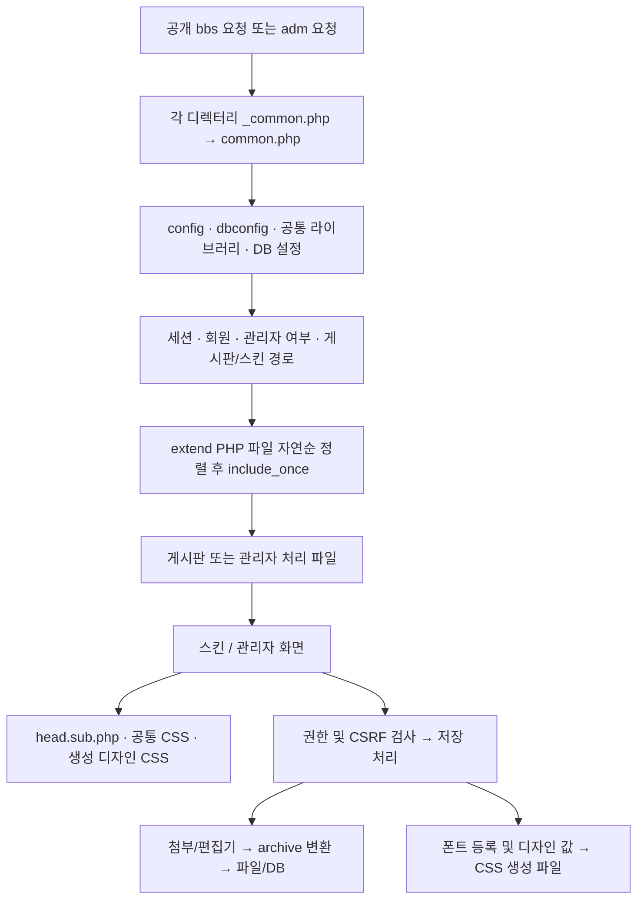

# 그누보드5 기반 구조 점검

점검 기준은 `master`의 `54c975f`(디자인 PR #2 병합)와 이번 기능 변경이다. PHP 8.4 대응 전 아보카도 기준점은 `c670d0e`다. `config.php`의 버전 표시는 아보카도 Light 2.2.2이므로 이를 그누보드5 upstream 버전으로 해석하면 안 된다. 원본 그누보드의 정확한 배포판과 전 파일을 대조한 감사는 이번 점검에 포함하지 않았다.

## 구조와 경계

| 영역 | 경로 | 역할과 수정 기준 |
|---|---|---|
| 그누보드 계열 기반 | `common.php`, `config.php`, `bbs/`, `lib/common.lib.php`, `adm/admin.lib.php` | 초기화·회원·권한·SQL·세션·게시판 요청 처리. 아보카도 및 PHP 8.4 수정이 섞여 있어 순정 파일로 덮어쓰지 않는다. |
| 아보카도 표현·도메인 | `extend/community.config.php`, `extend/mmb.lib.php`, `skin/board/character`, `skin/board/mmb`, `skin/menu`, `templete/` | 캐릭터·로드비·메뉴·디자인 helper. `templete`는 실제 디렉터리 철자다. |
| 개선판 추가 기능 | `lib/archive.lib.php`, `adm/archive.ajax.php`, `adm/js/archive-admin.js`, `bbs/archive_file.php` | 이미지 변환·디스크 측정·관리자 미리보기/비동기 저장·파일 권한 게이트. 서로 다른 책임이 한 파일에 모인 부분은 후속 분리 대상이다. |
| 이번 추가 기능 | `lib/tomo_settings.lib.php`, `lib/tomo_fonts.lib.php`, `adm/tomo_*.inc.php`, `adm/js/tomo-fonts.js`, `js/tomo-protection.js` | 설정·마이그레이션, 폰트 등록 및 CSS 생성, 관리자 화면, 공개 화면 보호. 핵심 로직을 화면과 분리했다. |
| 외부 패키지 | `plugin/` | 편집기·메일·SNS 등. 프로젝트 전체 Composer/autoload는 없고, 일부 외부 패키지만 자체 composer 파일을 가진다. 업로드 경로에는 로컬 수정이 있어 vendor 전체 교체도 위험하다. |
| 사용자 데이터 | `data/`, DB | Git에 넣지 않는다. 데이터 및 기존 스킨을 유지하는 추가형 마이그레이션을 사용한다. |

## 요청과 데이터 흐름

실제 흐름의 핵심 공유 상태는 `$g5`, `$config`, `$member`, `$is_admin`, `$board`, `$board_skin_path`다. `common.php`는 요청값을 재귀적으로 SQL escape한 뒤 `extract()`한다. 새 라이브러리는 암묵적인 추출 변수보다 명시적 인수를 우선하고, POST 경계에서 한 번만 `stripslashes()`한 뒤 저장 시 다시 SQL escape해야 한다. `extract()` 자체 제거는 광범위한 호환성 변경이므로 이번에는 하지 않았다.

디자인 설정은 DB의 CSS 행과 설정 테이블을 읽어 `data/css/_design.config.css`를 생성한다. 공개 화면은 공통 CSS → 생성 CSS → 반응형 보완 → 후에 삽입되는 스킨 CSS의 순서와 선택자 우선순위를 함께 고려해야 한다. 스킨 CSS 삽입은 `add_stylesheet()`/버퍼 처리를 사용하므로 파일을 읽은 순서만으로 최종 적용 순서를 단정하지 않는다.

## 현재 확장 지점

- `extend/`의 PHP 파일을 자연순으로 자동 로드한다. 무거운 쿼리·외부 HTTP·전역 렌더링은 넣지 않는다. 기존 함수와 이름이 겹치지 않는 접두사를 사용한다.
- 게시판 저장 전후에는 `write_update.head.skin.php`, `write_update.skin.php`, `write_update.tail.skin.php`를 포함하는 기존 경로가 있다. 실제 사용하는 저장 진입점 둘 모두를 확인해야 한다.
- 게시판·캐릭터·로드비·메뉴는 서로 다른 스킨 계약을 가진다. 메뉴는 `menu.php`가 설정된 스킨의 `css.config.php`, 방향별 `menu.*.inc.php`를 로드한다.
- 이 저장소에서 현대 그누보드의 범용 `add_event`/`run_event` 기반 구조는 확인하지 못했다. 최신 매뉴얼의 훅을 존재 여부 확인 없이 사용하지 않는다.

## 유지보수 위험과 단계별 분리안

| 순서 | 문제 | 권장 변경 | 필수 확인 |
|---|---|---|---|
| 1 | 첨부/편집기 경로·원본 삭제 정책이 여러 파일에 분산 | 업로드 형식·변환·파일 수명 인터페이스를 문서화하고 호출부별 어댑터로 통일 | 두 게시판 저장 경로, 두 편집기, 첨부 수정/삭제, 변환 실패 시 원본 유지 |
| 2 | `archive.lib.php`가 이미지·디스크·삭제를 함께 담당 | `archive_image`, `archive_disk`, `archive_files`로 분리하고 기존 함수명은 호환 facade 유지 | 기존 단위 테스트 및 디스크 합계/경로 제한/삭제 테스트 |
| 3 | `archive.ajax.php`가 미리보기·파일 inline·디스크 라우팅 혼합 | 액션별 handler와 별도의 preview renderer로 분리 | 인증·전용 토큰·CSP·sandbox·용량 제한 유지 |
| 4 | 큰 디자인 폼에서 숫자 인덱스와 렌더러가 직접 결합 | 디자인 항목 정의를 한 곳으로 모은 후 폼/저장/CSS에서 참조 | 모든 기존 `cs_name`/`cs_etc_*` 값, 저장 전후 CSS, 기존 커스텀 코드 보존 |
| 5 | SQL·HTML·전역 변수·요청 추출 변수 혼합 | 기존 함수의 입력/출력부터 명시하고 도메인 단위로 데이터 접근 분리 | 회원/권한/CSRF/게시글 회귀, 데이터 백업·복원 |

`lib/thumbnail.lib.php`는 포함 시 전역 PHP 메모리 제한을 해제하는 기존 부작용도 있습니다. 이미지 처리 모듈을 분리할 때 호출 순서와 메모리 상한을 함께 점검해야 합니다.

1~5는 후속 작업 제안이며 이번 PR에서 기존 기능을 대규모로 재배치하지 않았다. 폰트와 설정 라이브러리는 별도 함수로 추가했다. 편집기/SNS/메일 패키지의 버전 업그레이드는 별도의 호환성 작업이다.
